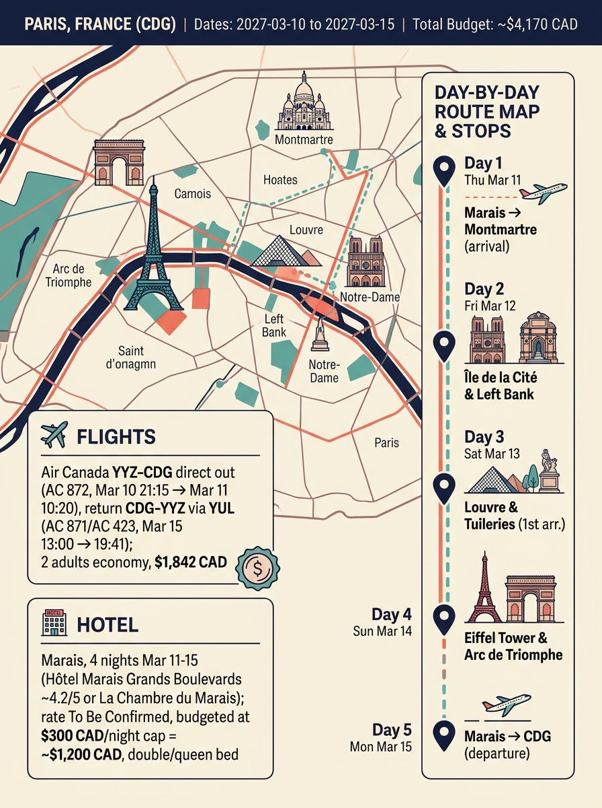
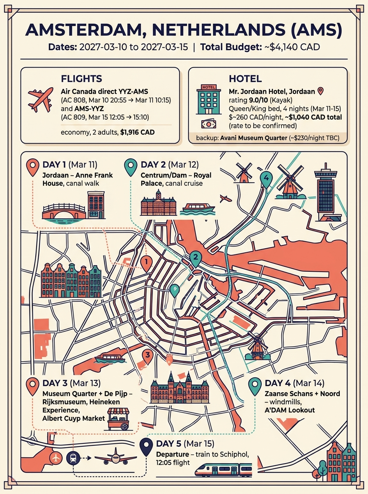

# TripPlanner MCP Server

An asynchronous **Model Context Protocol (MCP)** server built with Python that turns **Claude Desktop** into an end-to-end travel logistics agent. It reads personalized user constraints, fetches live round-trip flight pricing via **SerpApi (Google Flights)**, verifies real-time hotel rates and ratings via **Tavily**, and exports both a formatted **PDF itinerary** (`fpdf2`) and a custom illustrated **PNG travel infographic** (`gemini-3-pro-image`).

---

## Live Demo


https://github.com/user-attachments/assets/c88111ee-efa4-4d87-899d-96f504b83fb2


---

## Architecture & Multi-Model Orchestration

```text
+-------------------+       stdio (MCP)       +-----------------------------------+
|                   | <---------------------> |      TripPlanner MCP Server       |
|  Claude Desktop   |                         |        (travel_server.py)         |
| (Reasoning & Plan)| <---+                   +-----------------------------------+
+-------------------+     |                     |               |               |
        |                 |                     v               v               v
        | (MCP)           |            +--------------+  +------------+  +-------------+
        v                 |            | Preferences  |  |  SerpApi   |  |   Gemini    |
+-------------------+     |            |  Engine      |  |  Google    |  |   3 Pro     |
|    Tavily MCP     | ----+            | (data/*.txt) |  |  Flights   |  |   Image     |
| (Live Hotel & Web)|                  +--------------+  +------------+  +-------------+
+-------------------+                                                           |
                                                                                v
                                                                       +-----------------+
                                                                       |   output/       |
                                                                       |  - .pdf         |
                                                                       |  - _infographic |
                                                                       +-----------------+
```

### Workflow Execution
1. **`read_preferences`:** Loads persistent constraints from `data/preferences.txt` (budget caps, layover windows, bed/noise rules, 2-museum / 1-church limits, Must-See Priority ranking, daily step targets, and meal/coffee ratios) before planning begins.
2. **`search_flights`:** Queries real-time round-trip flights via SerpApi, enforces a maximum 1-layover and 2–6 hour layover duration filter *before* slicing top results, ranks by lowest price and shortest duration, and resolves matching return legs using `departure_token`.
3. **Live Hotel Verification (`Tavily`):** Cross-checks nightly rates, guest ratings, metro proximity, and room types against saved accommodation rules, applying a `To Be Confirmed` fallback when future seasonal rates are unavailable.
4. **`save_itinerary`:** Sanitizes Markdown tables and Unicode characters to export a clean multi-page PDF via `fpdf2`, while asynchronously generating a 3:4 editorial infographic poster via `gemini-3-pro-image` with dual HTTP (`60,000 ms`) and `asyncio.wait_for` (`60s`) timeouts so slow image calls never block the stdio event loop.

---

## Sample Generated Outputs

### Illustrated Travel Infographics (`gemini-3-pro-image`)
| Paris Primary (`paris_infographic_main.png`) | Amsterdam Primary (`amsterdam_infographic_main.png`) | Paris Alternate Style (`paris_infographic_alt.png`) |
| :---: | :---: | :---: |
|  |  |  |

### Exported PDF Itineraries
* **[View Paris Sample PDF Itinerary (`output/paris_itinerary.pdf`)](output/paris_itinerary.pdf)**
* **[View Amsterdam Sample PDF Itinerary (`output/amsterdam_itinerary.pdf`)](output/amsterdam_itinerary.pdf)**

---

## Project Structure

```text
TripPlanner-Project-MCP/
├── data/
│   └── preferences.txt                  # Persistent travel rules, budgets, and pacing constraints
├── output/
│   ├── paris_itinerary.pdf              # Sample Paris exported PDF itinerary
│   ├── paris_infographic_main.png       # Sample Paris Gemini 3 Pro Image poster
│   ├── paris_infographic_alt.png        # Alternate Paris Gemini 3 Pro Image poster
│   ├── amsterdam_itinerary.pdf          # Sample Amsterdam exported PDF itinerary
│   └── amsterdam_infographic_main.png   # Sample Amsterdam Gemini 3 Pro Image poster
├── .env.example                         # Environment variable template
├── .gitignore                           # Excludes .env, .venv, and future test outputs
├── .python-version                      # Pinned Python version
├── pyproject.toml                       # Project metadata and dependencies
├── travel_server.py                     # Main async MCP server implementation
└── uv.lock                              # Deterministic dependency lockfile
```

---

## Setup & Installation

### 1. Prerequisites
* Python 3.11+
* [`uv`](https://docs.astral.sh/uv/) package manager
* **Claude Desktop**
* API keys for [SerpApi](https://serpapi.com/), [Google AI Studio (Gemini)](https://aistudio.google.com/), and [Tavily](https://tavily.com/)

### 2. Clone & Install Dependencies
```bash
git clone https://github.com/EmadSoheili/TripPlanner-Project-MCP.git
cd TripPlanner-Project-MCP
uv sync
```

### 3. Configure Environment Variables
Copy `.env.example` to `.env` and add your API keys:
```bash
cp .env.example .env
```

```env
SERPAPI_API_KEY=your_serpapi_api_key
GEMINI_API_KEY=your_gemini_api_key
# Optional (used in Claude Desktop's tavily-mcp server config):
TAVILY_API_KEY=your_tavily_api_key
```

### 4. Register with Claude Desktop
Add both `trip-planner` and `tavily` to your Claude Desktop MCP configuration (`~/Library/Application Support/Claude/claude_desktop_config.json` on macOS):

```json
{
  "mcpServers": {
    "trip-planner": {
      "command": "/Users/YOUR_USERNAME/.local/bin/uv",
      "args": [
        "--directory",
        "/ABSOLUTE/PATH/TO/TripPlanner-Project-MCP",
        "run",
        "travel_server.py"
      ]
    },
    "tavily": {
      "command": "npx",
      "args": ["-y", "tavily-mcp@latest"],
      "env": {
        "TAVILY_API_KEY": "your_tavily_api_key"
      }
    }
  }
}
```

Restart Claude Desktop (`Cmd + Q`) and test with a prompt such as:
> *"Plan a 5-night trip to Paris (CDG) from 2027-03-10 to 2027-03-15 using my saved preferences and real-time flights, then save the itinerary."*

---

## Engineering Highlights
* **Pre-Slice Constraint Filtering:** Filters out invalid multi-stop or out-of-window layover flights (`< 2h` or `> 6h`) *before* slicing top results, preventing valid options from being dropped prematurely.
* **Non-Blocking Stdio Architecture:** Runs `gemini-3-pro-image` via `gemini_client.aio` wrapped in `asyncio.wait_for(..., timeout=60.0)` and `HttpOptions(timeout=60_000)` with graceful fallback so PDF export always succeeds even if image generation times out.
* **Fault-Tolerant Markdown-to-PDF Pipeline:** Normalizes Unicode punctuation/currency symbols and strips inline HTML tags inside `<td>`/`<th>` table cells before passing HTML to `fpdf2`.
